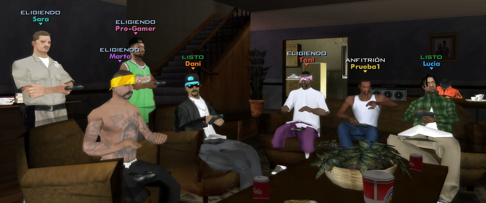
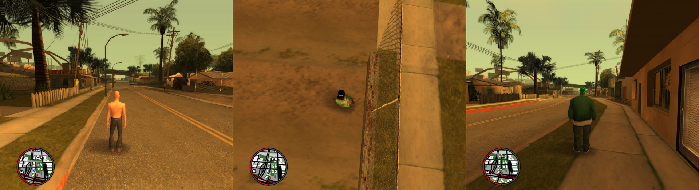
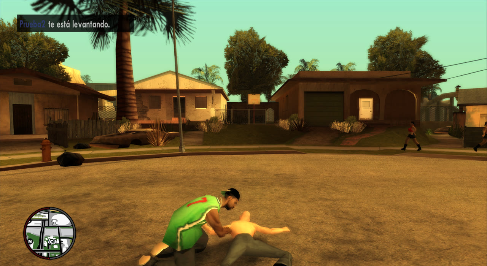
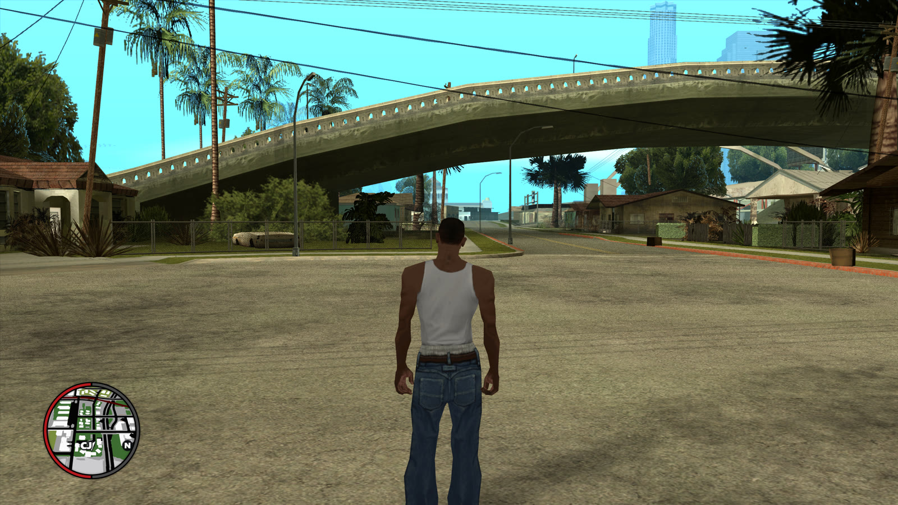

# San Andreas Reunited

[English](README.md) | Español

Un mod cooperativo para GTA San Andreas en PC. Juega la historia con hasta siete amigos por internet, o pásale un
mando a quien tengas al lado para jugar en la misma pantalla.



**[Descarga la última versión](../../releases/latest)**

## Qué es

Con San Andreas Reunited, hasta 8 jugadores comparten el mismo San Andreas. Todos os reunís en el salón de CJ, en Grove
Street, el anfitrión elige las reglas y empieza la partida, y salís por la puerta de la casa al mismo mundo: las
misiones de la historia, los trabajos secundarios, las guerras de bandas, los minijuegos y el modo libre, con los
demás a tu lado.

No hay cuentas ni servidores que alquilar. El PC del anfitrión aloja la partida y genera un código corto, como
`ABC-DEF-GHJ`, que los demás escriben para entrar. Quien juegue en el mismo PC entra en pantalla dividida con un
mando, y en una misma partida pueden coincidir jugadores por internet y en pantalla dividida.

## Funciones

### Historia y campaña

- Hasta 8 jugadores en una partida: el anfitrión y hasta siete amigos, por internet, en un mismo PC o de las dos
  formas a la vez.
- Las 95 misiones de la historia funcionan con guiones cooperativos. Por defecto las empieza el anfitrión; una regla
  de la sala permite que las empiece cualquiera.
- Las cinemáticas se reproducen en el juego de cada jugador. Si saltas una, solo recuperas tu cámara: la escena sigue
  para quien la esté viendo.
- La campaña del anfitrión es de todos: el mapa descubierto, los garajes y los coches guardados en ellos, las casas
  compradas, los saltos únicos, los objetos del mapa y los coleccionables.
- Al guardar en una casa se guarda también el progreso de cada invitado: armas, salud, chaleco, estadísticas y ropa.
- Trabajos secundarios para todos a la vez: taxi, paramédico, bombero, justiciero, carreras, autoescuelas y el resto
  funcionan en el juego de quien los empieza.
- Guerras de bandas con varios jugadores, sobre un mismo mapa de territorios para todos.
- Las llamadas de la historia que recibe el anfitrión también les llegan a los invitados.

### Sala y reglas

- Antes de jugar, todos os reunís en el salón de CJ: elige un personaje y un color, cámbiate de ropa en el armario y
  pulsa Estoy listo.
- El anfitrión elige las reglas de toda la partida: fuego amigo, dinero compartido o de cada uno, volver en el
  hospital o junto a un compañero, conservar las armas al morir, quién puede empezar misiones, trucos, cuántos
  jugadores (de 2 a 8) y si se puede entrar con la partida empezada.
- Las reglas se guardan con la partida y vuelven al cargarla.
- Más adelante, cualquiera puede cambiar de personaje en el armario de una casa, y el anfitrión puede volver a ser CJ
  con la ropa que llevaba.

### Entrar en una partida

- El anfitrión recibe un código y se lo pasa a los demás, que lo escriben, lo pegan o pegan el mensaje de invitación
  entero, del que el lanzador saca el código.
- El juego del anfitrión pide al router que abra su puerto (UPnP, PCP o NAT-PMP) y encuentra a los invitados por
  internet. También funciona en una red local o en una VPN como Radmin VPN o ZeroTier.
- Las actualizaciones se instalan al abrir el lanzador, así todos jugáis con la misma versión.

### Pantalla dividida

- Un jugador más en el mismo PC entra desde un mando libre manteniendo pulsados START y BACK a la vez durante un
  segundo.
- Cada jugador nuevo pasa por la sala en su propia vista y después aparece junto al primero, en un asiento libre de
  su coche si lo hay.
- Cada vista tiene su propio sonido y su propio radar, con la flecha de cada jugador en su color.
- En una misma partida se juntan sin problema jugadores en pantalla dividida y por internet.



### Chat de voz

- Voz por proximidad: cada voz sale del jugador que habla, se apaga con la distancia y suena apagada a través de las
  paredes, dentro de los coches y bajo el agua. Por defecto se pulsa para hablar, con otro botón para susurrar.
- El teléfono de CJ, para llamadas de uno a uno.
- Un walkie-talkie con cuatro canales: mantén pulsada su tecla y te oye todo tu canal, esté donde esté.
- Supresión de ruido y ganancia automática del micrófono.

### Juntos en el mundo

- Una rueda de gestos con diez bailes, dieciséis acciones y gestos (sentarse, tumbarse, apoyarse en la pared, fumar,
  beber, saludar, señalar, gestos de banda, algunos para dos jugadores) y diez reacciones que aparecen sobre tu
  cabeza.
- Dale a un compañero dinero o el arma que llevas en la mano.
- Cuando te quedas sin salud caes herido en vez de morir, y un compañero puede levantarte.
- Al morir, sigue la partida alrededor de otro jugador con tu propia cámara y vuelve cuando quieras.
- Viaja en el techo de un coche, en la caja de una camioneta, en un tren o en la cubierta de un barco mientras
  conduce otro, y dispara desde cualquier asiento de pasajero.
- Un único marcador en el mapa para todos: quien lo pone lo mueve para todo el grupo.
- Las radios de los coches emiten lo mismo para todos, y la música de un coche se oye desde fuera y se apaga con la
  distancia. Tus canciones de User Tracks suenan para todos los que estén dentro y alrededor de tu coche.
- Billar entre jugadores, las mesas del casino, duelos de baile y de lowriders, boxeo en el gimnasio, baloncesto y
  récords compartidos en las máquinas recreativas.
- Las muertes y los arrestos se anuncian en el chat.
- Un modo foto en el menú de pausa: cámara libre con objetivo, enfoque, apertura (profundidad de campo real),
  velocidad de obturación (desenfoque de movimiento real), horizonte y focos, y una galería para tus fotos.



### Aspecto y sensaciones

- Un HUD nuevo al estilo de GTA IV: radar redondo con cada jugador en su color e interiores marcados en el mapa.
- Pantalla panorámica hasta 32:9 sin estirar la imagen, y un ajuste de campo de visión de 60 a 100 grados.
- Una distribución de mando actual (RT para acelerar, LT para frenar). Se reconocen los mandos DualSense, DualShock 4,
  Switch Pro y Xbox, y en pantalla aparecen sus propios botones.
- Detalles al estilo de GTA IV: intermitentes y luces de emergencia, si sales deprisa de un coche la puerta queda
  abierta y el motor encendido, cojeas cuando estás malherido y puedes sacar a un conductor a punta de pistola.
- Los demás jugadores y sus coches se mueven con fluidez, sin saltos.
- Colores de PS2 (SkyGfx), activados por defecto y con opción de quitarlos en Opciones.
- SilentPatch y Framerate Vigilante: los arreglos de siempre y una física que sigue siendo correcta por encima de 30
  fps.
- En español y en inglés, según el idioma elegido en el juego.



## Requisitos

- Windows. Se desarrolla y se prueba en Windows 11, y está preparado para funcionar en Windows 7 y posteriores.
- Tu propia copia de GTA San Andreas para PC: la de Steam o la de Rockstar Games Launcher, o la versión 1.0. El
  instalador hace una copia aparte y la convierte en la versión 1.0, que es la que usa el mod. Tu instalación original
  se queda como estaba.
- Unos 6,5 GB libres en el disco para esa copia.
- Conexión a internet durante la instalación, para descargar los parches de la 1.0, SilentPatch y SkyGfx.
- Un micrófono, si quieres hablar.
- Para la pantalla dividida, un mando por cada jugador más y un PC capaz de mover una copia del juego por jugador.

No son compatibles la versión 2.0 del juego ni The Trilogy (Definitive Edition).

## Instalación

### La forma rápida

Pega esta línea en PowerShell, en el Símbolo del sistema o en el cuadro Ejecutar (Win+R) y pulsa Intro:

```
powershell -c "irm https://github.com/lautaroschenfeld/san-andreas-reunited/releases/latest/download/install.ps1 | iex"
```

Descarga el último instalador y lo abre.

### Con el instalador

1. Descarga el instalador (el archivo `.exe`) de la [última versión](../../releases/latest).
2. Ábrelo. Si Windows SmartScreen te avisa, pulsa "Más información" y después "Ejecutar de todas formas".
3. El instalador encuentra tu juego, hace la copia y la baja a la versión 1.0.
4. Abre San Andreas Reunited desde el menú Inicio o desde el escritorio.

### Instalación manual

El zip de cada versión es para una carpeta de GTA San Andreas 1.0 US que ya tengas:

1. Cambia el nombre del `eax.dll` del juego a `eax_orig.dll` antes de copiar nada.
2. Copia todo el contenido del zip en la carpeta del juego.
3. Abre el lanzador que venía en el zip.

### Comprobar la descarga

Cada versión incluye el SHA-256 de sus archivos en `SHA256SUMS.txt`. En PowerShell:

```powershell
Get-FileHash .\<archivo> -Algorithm SHA256
```

### Desinstalar

Desinstala San Andreas Reunited desde la Configuración de Windows, en Aplicaciones. Tu instalación original del juego nunca se
modificó.

## Cómo jugar

### Crear una partida

1. Abre San Andreas Reunited y elige **Crear partida**.
2. Escribe tu nombre. El juego se abre y arranca con él el servidor del anfitrión.
3. En la sala verás el código de tu partida: pásaselo a tus amigos.
4. Elige las reglas en **Configuración**, en el apartado **Partida**.
5. Pulsa **Empezar partida** cuando quieras. Quien siga eligiendo se queda en la casa y sale a jugar cuando termine.

### Unirse a una partida

1. Abre San Andreas Reunited y elige **Unirse a una partida**.
2. Escribe o pega el código, y escribe tu nombre debajo, en **Tu nombre**.
3. Pulsa **Entrar**. En la sala, elige un personaje y un color, y pulsa **Estoy listo**.

Si la partida ya ha empezado, también puedes entrar cuando el anfitrión lo permita.

### Pantalla dividida

1. Mientras juegas, conecta un mando que no use nadie.
2. Mantén pulsados START y BACK a la vez durante un segundo (Options y Create en un mando de PlayStation, Menú y Vista
   en uno de Xbox, + y - en uno de Switch).
3. El jugador nuevo pasa por la sala en su propia vista, pulsa Estoy listo y aparece junto al primero.
4. Para salir, ese jugador elige **Salir del juego** en su propio menú de pausa.

El primer jugador puede usar teclado y ratón o un mando. Cada jugador más abre otra copia del juego, así que el PC
trabaja más o menos como si moviera un juego por jugador.

### Controles

| Acción | Teclado y ratón | Mando |
|---|---|---|
| Chat | T | Mantén START |
| Rueda de gestos | Mantén B | Mantén BACK |
| Hablar | Botón 4 del ratón | Mantén abajo en la cruceta |
| Susurrar | Botón 5 del ratón | |
| Teléfono | M | Izquierda en la cruceta |
| Walkie-talkie | Mantén 3 | Mantén arriba en la cruceta |
| Dar dinero o un arma | Ponte frente a un compañero y mantén Tab | Ponte frente a un compañero y mantén B |
| Levantar a un compañero | Tab | B |
| Intermitentes (izquierdo, derecho, los dos) | Z, C, X | Izquierda o derecha en la cruceta, mantenida para los dos |
| Modo foto | Menú de pausa | Menú de pausa |

## Preguntas frecuentes

**¿Necesito tener el juego?**

Sí. San Andreas Reunited necesita una copia de GTA San Andreas para PC adquirida legalmente y nunca descarga el juego.

**¿Modifica mi instalación del juego?**

No. El instalador trabaja sobre una copia aparte y deja tu instalación como estaba.

**¿Tengo que abrir puertos para crear una partida?**

Normalmente no: el juego del anfitrión pide al router que abra su puerto. Si tu router no lo permite, redirige el
puerto UDP 6767 al PC del anfitrión, o juega con los demás por una VPN como Radmin VPN o ZeroTier, donde el código también funciona.

**Mi amigo no consigue entrar.**

Cuando las dos redes son muy restrictivas (un NAT simétrico en cada lado, habitual en algunas conexiones móviles y
compartidas), el juego encuentra al anfitrión pero no consigue conectar, y lo indica. Usa una VPN o abre el puerto
en el router del anfitrión. No son compatibles las conexiones que solo tienen IPv6.

**¿Cuántos podemos jugar?**

Hasta 8 en una partida, contando a los de la pantalla dividida.

**¿Puedo seguir con mis partidas guardadas?**

Las partidas guardadas del juego original pueden no cargar bien. Empieza una partida nueva desde la sala.

**¿Funcionan mis otros mods?**

Los scripts de CLEO y otros complementos `.asi` todavía no se han probado con San Andreas Reunited. De momento, juega sin ellos.

**¿Puedo tener un servidor en un PC que no juegue?**

Sí. El zip incluye `server.exe`: ejecuta `server.exe --code` y muestra un código nuevo para compartir.

**¿Por qué me avisa Windows SmartScreen?**

El instalador aún no está firmado. Pulsa "Más información" y después "Ejecutar de todas formas".

## Problemas conocidos

- La mayoría de las misiones de la historia aún no se han jugado de principio a fin con varios jugadores. Las
  primeras de Los Santos son las más probadas, y las siguientes todavía pueden fallar para los invitados.
- Dos redes muy restrictivas no pueden conectarse directamente (consulta las preguntas frecuentes).
- Las partidas guardadas del juego original pueden no cargar bien.
- Los scripts de CLEO y otros complementos `.asi` están sin probar.
- La pantalla dividida abre una copia del juego por jugador y necesita un PC potente.
- En pantalla dividida, una cinemática puede devolver la cámara al primer jugador un segundo después de empezar, como
  si la hubiera saltado.

## Privacidad

San Andreas Reunited no envía informes de errores ni datos de uso. Si el juego se cierra por un error, el registro y el volcado
de memoria se quedan en una carpeta dentro de la del juego, y tú decides si los compartes. Se conecta a los demás
jugadores, a servidores STUN públicos y a la DHT de BitTorrent para encontraros por el código, a tu router para abrir
el puerto y a GitHub para buscar actualizaciones y descargar SilentPatch y SkyGfx.

## Créditos

San Andreas Reunited usa estos proyectos, conforme a sus licencias:

| Proyecto | Autor | Licencia | Para qué |
|---|---|---|---|
| [plugin-sdk](https://github.com/DK22Pac/plugin-sdk) | DK22Pac y colaboradores | zlib | Acceso al código del juego |
| [SilentPatch](https://github.com/CookiePLMonster/SilentPatch) | Silent | MIT | Arreglos del juego, descargado de su publicación |
| [Framerate Vigilante](https://github.com/GTAmodding/FramerateVigilante) | GTAmodding (Junior_Djjr y colaboradores) | MIT | Física y efectos por encima de 30 fps |
| [SkyGfx](https://github.com/aap/skygfx) | aap | Sin licencia publicada | Colores de PS2, descargado de su publicación y nunca redistribuido |
| [ENet](https://github.com/lsalzman/enet) | Lee Salzman | MIT | Red |
| [dht](https://github.com/jech/dht) | Juliusz Chroboczek | MIT | Encontrar una partida por su código |
| [miniupnpc](https://github.com/miniupnp/miniupnp) | Thomas Bernard | BSD-3-Clause | Abrir el puerto del anfitrión |
| [Opus](https://opus-codec.org) | Xiph.Org Foundation y colaboradores | BSD-3-Clause | Códec de voz |
| [RNNoise](https://github.com/xiph/rnnoise) | Jean-Marc Valin y colaboradores | BSD-3-Clause | Supresión de ruido |
| [SpeexDSP](https://github.com/xiph/speexdsp) | Xiph.Org Foundation | BSD-3-Clause | Procesado de la voz |
| [miniaudio](https://github.com/mackron/miniaudio) | David Reid | Dominio público (Unlicense) o MIT-0 | Dispositivos de audio |
| [SDL 3](https://libsdl.org) | Sam Lantinga y el equipo de SDL | zlib | Mandos |
| [Dear ImGui](https://github.com/ocornut/imgui) | Omar Cornut | MIT | Herramientas de desarrollo |
| [inih](https://github.com/benhoyt/inih) | Ben Hoyt | BSD-3-Clause | Archivos de configuración |
| [UTF8-CPP](https://github.com/nemtrif/utfcpp) | Nemanja Trifunovic | Boost Software License 1.0 | Codificación del texto |
| [serialize](https://github.com/mas-bandwidth/serialize) | Mas Bandwidth LLC | BSD-3-Clause | Paquetes de red |
| [Discord RPC](https://github.com/discord/discord-rpc) | Discord | MIT | Estado en Discord |
| [Jetpack Downgrader](https://github.com/Zalexanninev15/Jetpack-Downgrader) | Zalexanninev15 | MIT | Los parches de la 1.0, descargados de su publicación |
| [JojoDiff](https://jojodiff.sourceforge.net) | Joris Heirbaut | GPL-3.0-or-later | Aplicar los parches de la 1.0 |

Los mods de interfaz del paquete visual son obra de sus autores: Atmosphere Interface Pack, Remastered Radar Icons,
Mobile Font Fixed y Loadscreens 4K Definitive.

## Aviso legal

San Andreas Reunited es un mod hecho por aficionados. No está afiliado, respaldado ni patrocinado por Rockstar Games ni por
Take-Two Interactive. Grand Theft Auto y San Andreas son marcas comerciales de Take-Two Interactive Software, Inc.

Necesita una copia de GTA San Andreas para PC adquirida legalmente y nunca descarga el juego: el instalador trabaja
sobre la copia que ya tienes.
