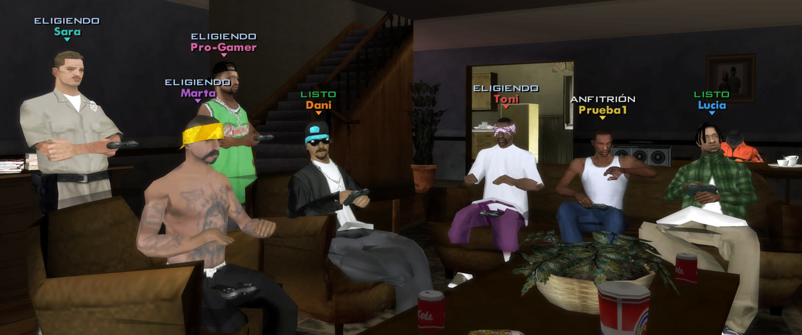
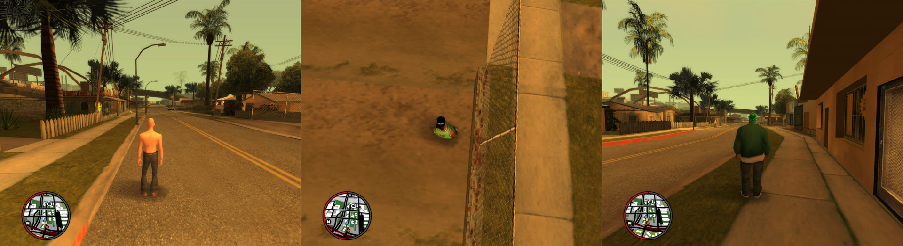
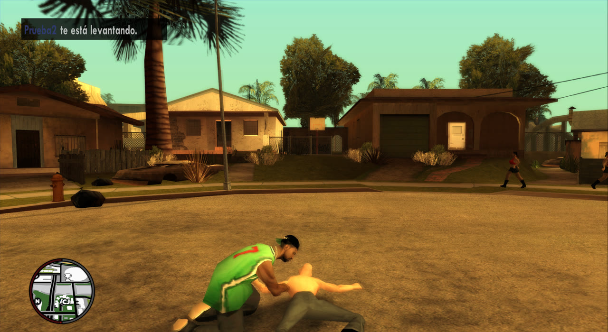
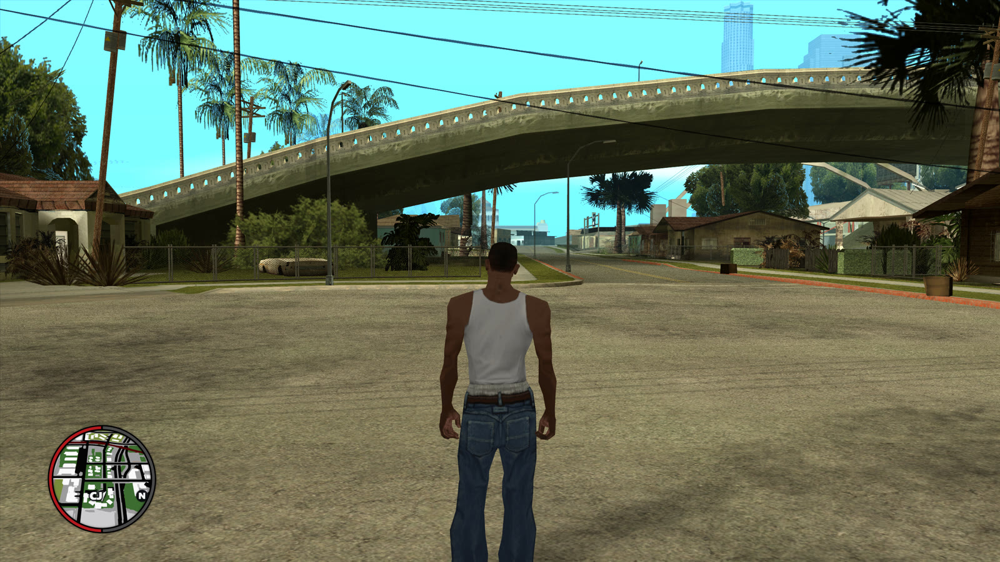

# San Andreas Reunited

English | [Español](README.es.md)

A co-op mod for GTA San Andreas on PC. Play the story with up to seven friends over the internet, or hand a pad to
someone next to you and share one screen.



**[Download the latest release](../../releases/latest)**

## What it is

With San Andreas Reunited, up to 8 players share one San Andreas. Everyone meets in CJ's living room on Grove Street, the host
sets the rules and starts the game, and you all walk out of the front door into the same world: the story missions,
side jobs, gang wars, minigames and free roam, with the others beside you.

There are no accounts and no server to rent. The host's PC runs the game, gets a short code like `ABC-DEF-GHJ`, and
the others type it in to join. Players on the same PC join in split screen with a pad, and online and split screen
players can share the same game.

## Features

### Story and campaign

- Up to 8 players in one game: the host and up to seven friends, online, on one PC, or both at once.
- The 95 story missions run with co-op scripts. The host starts them by default; a lobby rule lets anyone do it.
- Cutscenes play in every player's game. Skipping one only gives you your own camera back, so the scene goes on for
  whoever is still watching it.
- The host's campaign belongs to everyone: the explored map, the garages and the cars kept in them, the houses bought,
  the unique stunt jumps, the map's pickups and the collectibles.
- Saving at a safehouse keeps every guest's progress too: weapons, health, armour, stats and clothes.
- Side jobs for everyone at the same time: taxi, paramedic, firefighter, vigilante, races, schools and the rest run
  in the game of whoever starts them.
- Gang wars with several players, on one territory map for everybody.
- The story's phone calls to the host show up for the guests as well.

### Lobby and rules

- Before playing, everyone gathers in CJ's living room: pick a character and a colour, change clothes at the
  wardrobe, then press Ready.
- The host picks the rules for the whole game: friendly fire, shared or separate money, coming back at the hospital
  or next to a teammate, keeping your weapons after dying, who can start missions, cheats, how many players (2 to 8)
  and whether people can join once the game is on.
- The rules are saved with the game, so loading a save brings them back.
- Later on, anyone can change character at a safehouse wardrobe, and the host can go back to CJ in the clothes he had.

### Joining

- The host gets a code and sends it to the others. They type it, paste it, or paste the whole invite message, and the
  launcher picks the code out.
- The host's game asks the router to open its port by itself (UPnP, PCP or NAT-PMP) and finds the guests over the
  internet. It also works on a home network or a VPN such as Radmin VPN or ZeroTier.
- Updates install when the launcher opens, so everyone plays the same version.

### Split screen

- An extra player on the same PC joins from a free pad by holding START and BACK together for a second.
- Each new player goes through the lobby in their own view, then appears next to the first player, in a free seat of
  their car if there is one.
- Every view has its own sound and its own radar, with each player's arrow in their colour.
- Split screen players and online players mix freely in the same game.



### Voice chat

- Proximity voice: each voice comes from the player who speaks, fades with distance and sounds muffled through walls,
  inside cars and under water. Push to talk by default, with a separate button to whisper.
- CJ's phone for one-to-one calls.
- A walkie radio with four channels: hold its key and everyone on your channel hears you, wherever they are.
- Noise suppression and automatic gain for the microphone.

### Together in the world

- An emote wheel with ten dances, sixteen actions and gestures (sitting, lying down, leaning on a wall, smoking,
  drinking, waving, pointing, gang signs, a few for two players) and ten reactions shown over your head.
- Give a teammate money or the gun in your hand.
- When your health runs out you go down instead of dying, and a teammate can get you back on your feet.
- After dying, follow the game around another player with your own camera, and come back when you choose.
- Ride on a car's roof, in a pickup's bed, on a train or on a boat's deck while someone else drives, and shoot from
  any passenger seat.
- One map marker for everyone: whoever places it moves it for the whole group.
- Car radios play the same programme for every player, and a car's music is heard from outside it, fading with the
  distance. Your own User Tracks play for everyone in and around your car.
- Pool against each other, the casino tables, dance and lowrider duels, boxing at the gym, basketball and shared
  arcade records.
- Deaths and arrests are announced in the chat.
- A photo mode in the pause menu: a free camera with lens, focus, aperture (real depth of field), shutter speed (real
  motion blur), horizon and spotlights, and a gallery for your shots.



### Look and feel

- A new HUD in the style of GTA IV: a round radar with every player in their colour, and interiors marked on the map.
- Widescreen up to 32:9 without stretching, and a field of view setting from 60 to 100 degrees.
- A modern pad layout (RT to accelerate, LT to brake). DualSense, DualShock 4, Switch Pro and Xbox pads are
  recognised, and the screen shows their own buttons.
- Details in the style of GTA IV: turn signals and hazard lights, a car left in a hurry keeps its door open and its
  engine running, a limp when you are badly hurt, and pulling a driver out at gunpoint.
- Other players and their cars move smoothly, without jumps.
- PS2 colours (SkyGfx), on by default and switchable in Options.
- SilentPatch and Framerate Vigilante: the well-known fixes, and physics that stay right above 30 fps.
- Spanish and English, following the language chosen in the game.



## Requirements

- Windows. It is developed and tested on Windows 11, and built to run on Windows 7 and later.
- Your own copy of GTA San Andreas for PC: the Steam or Rockstar Games Launcher release, or version 1.0. The setup
  makes a separate copy and turns that copy into version 1.0, which the mod runs on. Your original install is left as
  it was.
- About 6.5 GB of free disk space for that copy.
- An internet connection during the install, to download the 1.0 patches, SilentPatch and SkyGfx.
- A microphone if you want to talk.
- For split screen, a pad for each extra player, and a PC that can run one copy of the game per player.

Version 2.0 of the game and The Trilogy (Definitive Edition) are not supported.

## Install

### The quick way

Paste this line into PowerShell, a Command Prompt or the Run box (Win+R) and press Enter:

```
powershell -c "irm https://github.com/lautaroschenfeld/san-andreas-reunited/releases/latest/download/install.ps1 | iex"
```

It downloads the latest setup and starts it.

### With the setup

1. Download the setup (the `.exe` file) from the [latest release](../../releases/latest).
2. Open it. If Windows SmartScreen warns you, press "More info" and then "Run anyway".
3. The setup finds your game, makes the copy and downgrades it to 1.0.
4. Open San Andreas Reunited from the Start menu or the desktop.

### Manual install

The zip of each release is for a GTA San Andreas 1.0 US folder you already have:

1. Rename the game's `eax.dll` to `eax_orig.dll` before copying anything.
2. Copy everything in the zip into the game folder.
3. Open the launcher that came in the zip.

### Checking the download

Every release lists the SHA-256 of its files in `SHA256SUMS.txt`. In PowerShell:

```powershell
Get-FileHash .\<file> -Algorithm SHA256
```

### Uninstall

Uninstall San Andreas Reunited from Windows Settings, under Apps. Your original game install was never touched.

## How to play

### Host a game

1. Open San Andreas Reunited and choose **Create game**.
2. Type your name. The game starts, and the host's server starts with it.
3. In the lobby you will see your game's code: send it to your friends.
4. Set the rules in **Settings**, under **Game**.
5. Press **Start game** when you are ready. Whoever is still choosing stays in the house and joins when they are
   done.

### Join a game

1. Open San Andreas Reunited and choose **Join a game**.
2. Type or paste the code, and type your name under it.
3. Choose **Join**. In the lobby, pick a character and a colour, then press **Ready**.

If the game has already started, you can still join when the host allows it.

### Split screen

1. While playing, connect a pad nobody is using.
2. Hold START and BACK together for a second (Options and Create on a PlayStation pad, Menu and View on an Xbox pad,
   + and - on a Switch pad).
3. The new player goes through the lobby in their own view, presses Ready and appears next to the first player.
4. To leave, that player chooses **Quit Game** in their own pause menu.

The first player can use the keyboard and mouse or a pad. Each extra player runs one more copy of the game, so the PC
works about as hard as if it ran one game per player.

### Controls

| Action | Keyboard and mouse | Pad |
|---|---|---|
| Chat | T | Hold START |
| Emote wheel | Hold B | Hold BACK |
| Push to talk | Mouse button 4 | Hold down on the d-pad |
| Whisper | Mouse button 5 | |
| Phone | M | Left on the d-pad |
| Walkie radio | Hold 3 | Hold up on the d-pad |
| Give money or a gun | Face a teammate and hold Tab | Face a teammate and hold B |
| Get a teammate up | Tab | B |
| Turn signals (left, right, both) | Z, C, X | Left or right on the d-pad, held for both |
| Photo mode | Pause menu | Pause menu |

## FAQ

**Do I need to own the game?**

Yes. San Andreas Reunited needs a legally owned PC copy of GTA San Andreas and never downloads the game.

**Will it change my game install?**

No. The setup works on a separate copy and leaves your install as it was.

**Do I need to open ports to host?**

Usually not: the host's game asks the router to open its port. If your router doesn't allow it, forward UDP port 6767
to the host's PC, or play over a VPN such as Radmin VPN or ZeroTier, where the code works too.

**My friend can't get in.**

When both networks are very strict (a symmetric NAT on each side, common on some mobile and shared connections), the
game finds the host but can't get through, and it says so. Use a VPN, or open the port on the host's router.
Connections that only have IPv6 are not supported.

**How many people can play?**

Up to 8 in one game, split screen players included.

**Can I keep playing my old saves?**

Saves from the original game may not load correctly. Start a new game in the lobby.

**Do my other mods work?**

CLEO scripts and other `.asi` plugins have not been tested with San Andreas Reunited yet. Play without them for now.

**Can I run a server on a PC that doesn't play?**

Yes. The zip has `server.exe`: run `server.exe --code` and it prints a new code to share.

**Why does Windows SmartScreen warn me?**

The setup isn't signed yet. Press "More info" and then "Run anyway".

## Known issues

- Most story missions haven't been played start to finish with several players yet. The first Los Santos missions
  are the most tested, and later ones can still misbehave for the guests.
- Two very strict networks can't meet directly (see the FAQ).
- Saves from the original game may not load correctly.
- CLEO scripts and other `.asi` plugins are untested.
- Split screen runs one copy of the game per player and needs a strong PC.
- In split screen, a cutscene can give the first player's camera back a second after it starts, as if it had been
  skipped.

## Privacy

San Andreas Reunited sends no crash reports and no usage data. When the game crashes, the log and the memory dump stay in a
folder inside the game folder, and you decide whether to share them. The connections it makes are to the other
players, to public STUN servers and the BitTorrent DHT to find each other by code, to your router to open the port,
and to GitHub to check for updates and download SilentPatch and SkyGfx.

## Credits

San Andreas Reunited is built with these projects, used under their licenses:

| Project | Author | License | Used for |
|---|---|---|---|
| [plugin-sdk](https://github.com/DK22Pac/plugin-sdk) | DK22Pac and contributors | zlib | Access to the game's code |
| [SilentPatch](https://github.com/CookiePLMonster/SilentPatch) | Silent | MIT | Fixes for the game, downloaded from its release |
| [Framerate Vigilante](https://github.com/GTAmodding/FramerateVigilante) | GTAmodding (Junior_Djjr and contributors) | MIT | Physics and effects above 30 fps |
| [SkyGfx](https://github.com/aap/skygfx) | aap | No license published | PS2 colours, downloaded from its release and never redistributed |
| [ENet](https://github.com/lsalzman/enet) | Lee Salzman | MIT | Networking |
| [dht](https://github.com/jech/dht) | Juliusz Chroboczek | MIT | Finding a game by its code |
| [miniupnpc](https://github.com/miniupnp/miniupnp) | Thomas Bernard | BSD-3-Clause | Opening the host's port |
| [Opus](https://opus-codec.org) | Xiph.Org Foundation and contributors | BSD-3-Clause | Voice codec |
| [RNNoise](https://github.com/xiph/rnnoise) | Jean-Marc Valin and contributors | BSD-3-Clause | Noise suppression |
| [SpeexDSP](https://github.com/xiph/speexdsp) | Xiph.Org Foundation | BSD-3-Clause | Voice processing |
| [miniaudio](https://github.com/mackron/miniaudio) | David Reid | Public domain (Unlicense) or MIT-0 | Audio devices |
| [SDL 3](https://libsdl.org) | Sam Lantinga and the SDL team | zlib | Game pads |
| [Dear ImGui](https://github.com/ocornut/imgui) | Omar Cornut | MIT | Developer tools |
| [inih](https://github.com/benhoyt/inih) | Ben Hoyt | BSD-3-Clause | Settings files |
| [UTF8-CPP](https://github.com/nemtrif/utfcpp) | Nemanja Trifunovic | Boost Software License 1.0 | Text encoding |
| [serialize](https://github.com/mas-bandwidth/serialize) | Mas Bandwidth LLC | BSD-3-Clause | Network packets |
| [Discord RPC](https://github.com/discord/discord-rpc) | Discord | MIT | Discord status |
| [Jetpack Downgrader](https://github.com/Zalexanninev15/Jetpack-Downgrader) | Zalexanninev15 | MIT | The 1.0 patches, downloaded from its release |
| [JojoDiff](https://jojodiff.sourceforge.net) | Joris Heirbaut | GPL-3.0-or-later | Applying the 1.0 patches |

The interface mods in the visual pack are the work of their authors: Atmosphere Interface Pack, Remastered Radar
Icons, Mobile Font Fixed and Loadscreens 4K Definitive.

## Legal

San Andreas Reunited is a fan-made mod. It is not affiliated with, endorsed by or sponsored by Rockstar Games or Take-Two
Interactive. Grand Theft Auto and San Andreas are trademarks of Take-Two Interactive Software, Inc.

It needs a legally owned PC copy of GTA San Andreas and never downloads the game: the setup works on the copy you
already have.
